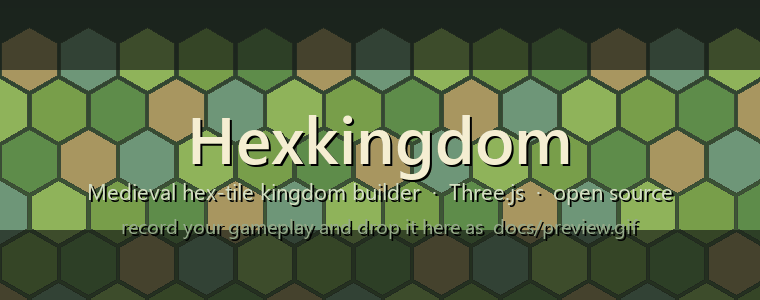

# 👑 Hexkingdom

A medieval **hex-tile kingdom builder** that runs entirely in the browser — no
game engine, no bundler, no build step. Place terrain tiles, grow a living
low-poly realm, run its economy, raise an army and conquer the frontier.

Built with **Three.js + vanilla ES modules**. Just open the file and play.

> 🌾 *Inspired by [Dorfromantik](https://toukana.com/dorfromantik/) by Toukana
> Interactive.* Hexkingdom is an independent fan-made project — not affiliated
> with or endorsed by Toukana.

<p align="center">
  
</p>

## 🌐 Play online

**[https://leks2000.github.io/Hexkingdom/](https://leks2000.github.io/Hexkingdom/)**

Hosted on GitHub Pages from the `main` branch.

## ▶ Run locally

Any static file server works — there is nothing to build:

```bash
# from the project root
python3 -m http.server 8123
# then open http://localhost:8123/
```

or

```bash
npx serve .
```

## 🎮 Controls

| Input | Action |
|---|---|
| **Click** (LMB) | Place the tile in hand / select a tile |
| **R** / right-click | Rotate the tile in hand |
| **V** | Shuffle the tile's edges |
| **LMB drag** | Pan camera (with release inertia) |
| **RMB / MMB / Shift+drag** | Rotate camera (yaw + pitch) |
| **Mouse wheel** / pinch | Zoom toward the cursor |
| **WASD / arrows** | Pan camera |
| **Q / E** | Rotate camera in 60° steps |

## 🧩 Gameplay

1. **Place hex tiles** (Forest, Field, River, Mountain, Village, Hills…) next to
   your kingdom. Matching edges score points; clusters and perfect alignments
   give big multipliers and chains.
2. **Tiles evolve on their own** — trees thicken, crops sprout, houses rise in
   staged construction, windmills spin, villages grow into towns and castles,
   and roads crossing rivers auto-build bridges.
3. **Run an economy** — buildings produce wood, stone, food, gold and influence.
   Trade buildings **auto-sell surplus** for gold; caravans roll along your
   roads and pay out on every trip.
4. **Research a tech tree** — Agriculture, Mining, Trade, Engineering, Military,
   Warfare and tool upgrades (Crop Rotation, Iron Tools, Crossbows) that boost
   production, construction and army strength.
5. **Grow your kingdom's tier** — Settlement → Village → Town → City → Kingdom.
   Each tier unlocks tiles, raises storage, boosts production and expands your
   army cap. Keep **stability** up (fed population + temples/banners/garrisons)
   to keep the whole economy multiplying.
6. **Field an army and conquer** — recruit Swordsmen, Archers and Knights at
   barracks & garrisons, then **attack enemy border tiles**. Win and the tile
   joins your realm; lose and you take casualties. Hostile factions expand,
   raid and capture back — hold the frontier with walls, towers and troops.

Progress (grid, score, evolution age, economy, research, army, RNG stream)
auto-saves to `localStorage` and restores on reload.

## 🏗 Tech highlights

- **Procedural everything** — tiles, buildings, nature and units are generated
  in code as vertex-colored merged geometry (one draw call per asset).
- **Deterministic seeded RNG** (mulberry32) — the same seed rebuilds the same
  world, so saves and replays are exact.
- **Phased construction** — every building rises foundation → structure →
  details → decoration.
- **Instanced nature** with 2-level LOD, and **wind/water animated in vertex
  shaders** (`onBeforeCompile`) for zero per-frame CPU cost on foliage.
- **Event-driven systems** — economy, factions, army, caravans and UI talk over
  a tiny pub/sub bus; no per-frame world scans.

## ✅ Tests

```bash
pip install playwright && python3 -m playwright install chromium
python3 -m http.server 8123 &
python3 test/run_headless.py                              # full game boot
python3 test/run_headless.py http://localhost:8123/test/smoke_military.html
```

The headless suite boots the real game and asserts new-game state, placement &
rotation, adjacency invariants, scoring, save round-trip, evolution spawning and
restart flow. The smoke suite verifies every procedural model, building/research
wiring and army unit definitions.

## 🛠 Built with Claude

Large parts of Hexkingdom's systems were designed and implemented with
**[Claude](https://claude.com/claude-code)** (Fable 5) — pair-programming the
procedural asset pipeline, economy, faction AI and combat.

## 📄 License

[MIT](LICENSE) — free to use, fork, modify and share.
